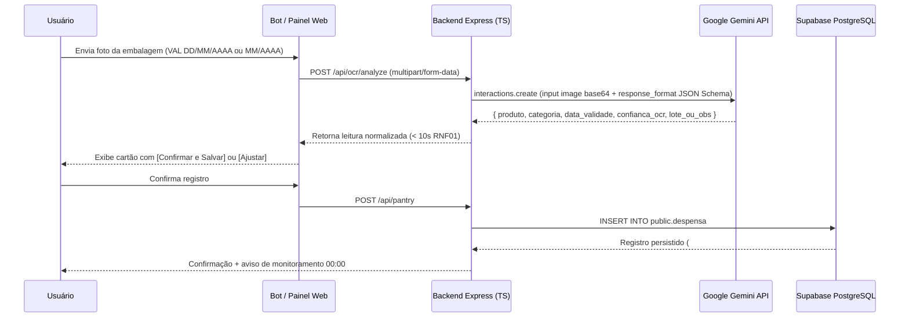
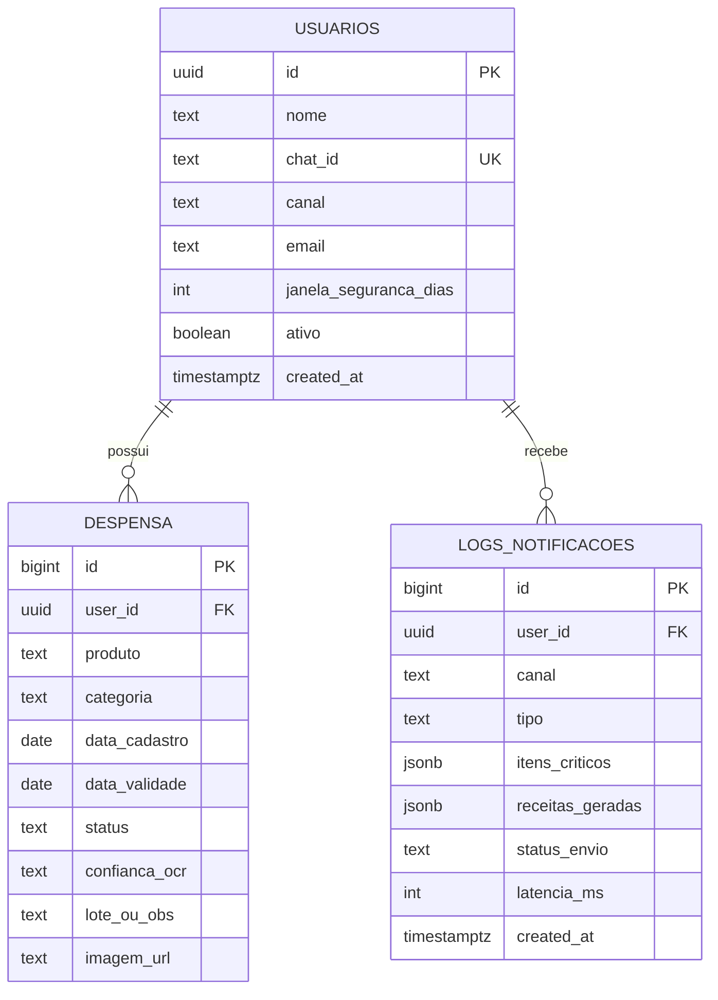

# Planejamento Técnico e Executivo Completo — Smart Pantry Assistant MVP

## 1. Definição do Problema

### Contexto e Dor do Usuário
O desperdício doméstico de alimentos (grãos, laticínios, hortifruti) e suplementos nutricionais (whey protein, pasta de amendoim zero lactose, suco verde em pó) ocorre pela falta de visibilidade contínua sobre datas de validade de itens armazenados em armários e despensas.

### Limitações das Soluções Atuais
- **Alto atrito na entrada de dados**: digitação manual após as compras leva ao abandono. Códigos de barras (EAN-13) identificam apenas o produto genérico, não o lote nem a validade específica daquela unidade física.
- **Alertas passivos e isolados**: notificar que um produto vence amanhã não responde à dúvida prática de como aproveitá-lo rapidamente com o restante dos ingredientes já disponíveis em casa.

### Declaração do Problema
> *Como reduzir o desperdício doméstico de alimentos e suplementos eliminando a fricção do cadastro manual de validades e transformando alertas de vencimento em sugestões práticas de preparo baseadas no estoque real do usuário?*

---

## 2. Arquitetura da Solução (API-First e Conteinerizada)

```mermaid
flowchart LR
    U["Usuário (Telegram / WhatsApp / Web)"] -->|Foto ou Comando| BOT["Bot / Frontend React"]
    BOT -->|HTTP / Webhook| N8N["n8n (Docker) / Backend Express TS"]
    N8N -->|@google/genai Interactions API| GEMINI["Google Gemini API (gemini-4-hydrogen)"]
    N8N -->|CRUD & Auditoria| DB["Supabase PostgreSQL (ou JSON Local)"]
    CRON["Cron Job 00:00 (n8n / node-cron)"] -->|Varredura <= 5 dias| DB
    CRON -->|Cross-Check + Receitas JSON| GEMINI
    CRON -->|Alerta Ativo Markdown + Links| U
```

### Fluxo de Captura e Confirmação (RF01 a RF04)



---

## 3. Modelagem de Dados (Supabase PostgreSQL)



---

## 4. Matriz Impacto x Esforço

| Quadrante | Classificação | Entregas | Decisão de Escopo |
|---|---|---|---|
| **Alto Impacto x Baixo Esforço** | Quick Wins | Bot Telegram/WhatsApp, OCR Gemini Vision, Persistência Supabase, Cron diário 00:00, Curadoria IA de receitas | **Prioridade 1 (Implementado no MVP)** |
| **Baixo Impacto x Baixo Esforço** | Incrementos Simples | Comandos `/estoque`, `/consumido <id\|nome>`, `/resumo` e Resumo Semanal por e-mail | **Prioridade 2 (Implementado no MVP)** |
| **Alto Impacto x Alto Esforço** | Projetos Estratégicos | App nativo Flutter / React Native + Leitura de QR Code de NFC-e | **Backlog Versão 2.0** |
| **Baixo Impacto x Alto Esforço** | Distrações / Evitar | Integração de recompra automática com mercados e rede social de receitas | **Fora de Escopo** |

---

## 5. Rastreabilidade de Requisitos (RF e RNF)

| Código | Requisito | Implementação no Projeto |
|---|---|---|
| **RF01** | Captura via Mensageria | `backend/src/routes/webhooks.routes.ts`, `infra/n8n/workflow-capture-ocr.json`, `BotSimulatorTab.tsx` |
| **RF02** | Identificação Visual e OCR via IA | `backend/src/services/gemini.service.ts` (`analyzeProductImage` com `@google/genai`) |
| **RF03** | Confirmação de Leitura | Cartão interativo com edição de nome/data + validação antes de gravar |
| **RF04** | Persistência no Banco de Dados | `infra/supabase/migrations/001_init.sql` + `backend/src/services/pantry.repository.ts` |
| **RF05** | Gestão de Estoque por Comando | `backend/src/services/bot.service.ts` (`/estoque`, `/consumido <id\|nome>`, `/resumo`, `/alerta`) |
| **RF06** | Monitoramento Diário 00:00 | `backend/src/services/cron.service.ts` (`node-cron`) + `infra/n8n/workflow-cron-recipes.json` |
| **RF07** | Cruzamento de Ingredientes e Receitas | `geminiService.curateAntiWasteRecipes` (JSON Schema estruturado) |
| **RF08** | Disparo de Notificação Ativa | `botService.sendTelegramMessage` / `sendWhatsAppMessage` + alertas Markdown no chat |
| **RNF01** | Tempo de Resposta < 10s | Medição de `latencyMs` em OCR e Cron + retry exponencial |
| **RNF02** | Tolerância Visual no OCR (`DD/MM/AAAA` e `MM/AAAA`) | Prompt especializado + `normalizeBrazilianDate` (`backend/src/utils/date.ts` + `date.test.ts`) |
| **RNF03** | Conteinerização e Portabilidade | `infra/docker-compose.yml`, `backend/Dockerfile`, `frontend/Dockerfile` |
| **RNF04** | Confiabilidade e Isolamento no Cron | `try/catch` isolado por usuário no loop do `cronService` + `continueOnFail` no n8n |
| **RNF05** | Segurança e Privacidade | Credenciais restritas ao `.env` no backend, `.gitignore`, RLS no Supabase |
| **RNF06** | Escalabilidade API-First | REST API desacoplada pronta para consumo futuro por Flutter / React Native |

---

## 6. Análise de Viabilidade
- **Técnica**: Plenamente viável — stack madura (`@google/genai`, Supabase PostgreSQL, Express/TS, Docker, n8n).
- **Operacional**: Plenamente viável — reduz cadastro de minutos para segundos via foto no hábito diário de mensageria.
- **Econômica**: Baixíssimo custo — Free Tier do Supabase (500 MB), Free Tier + créditos Google AI Pro no Google AI Studio e hospedagem enxuta em contêiner Docker (R\$ 0 a R\$ 30/mês).

---

## 7. Matriz 5W2H e Cronograma de 6 Meses

| Fase | Mês 1 | Mês 2 | Mês 3 | Mês 4 | Mês 5 | Mês 6 |
|---|:---:|:---:|:---:|:---:|:---:|:---:|
| 1. Concepção (Problema, MVP, RF/RNF, 5W2H) | X | | | | | |
| 2. Infraestrutura (Docker, n8n, Backend API e Supabase SQL) | X | X | | | | |
| 3. Visão e OCR (Bot + Gemini Vision API) | | X | X | | | |
| 4. Persistência (Gravação automática e comandos `/estoque`) | | | X | | | |
| 5. Automação e Receitas (Cron 00:00 + Curadoria IA) | | | X | X | | |
| 6. Notificações Ativas (Alertas no Chat + Resumo Semanal) | | | | X | X | |
| 7. Homologação (Testes reais, ajuste de prompt e métricas OCR) | | | | | X | |
| 8. Entrega Final (Relatório técnico e apresentação MVP) | | | | | X | X |
